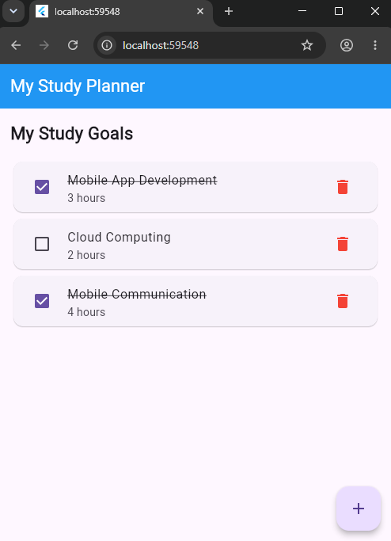
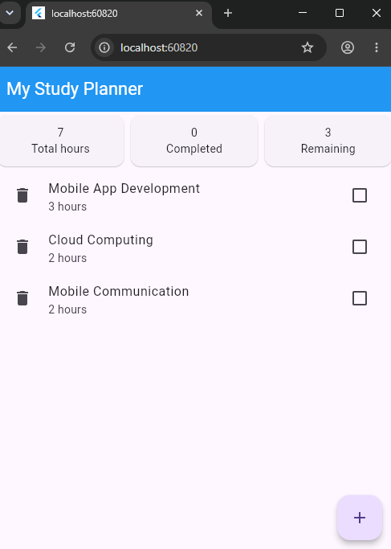
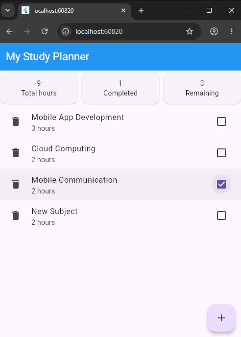
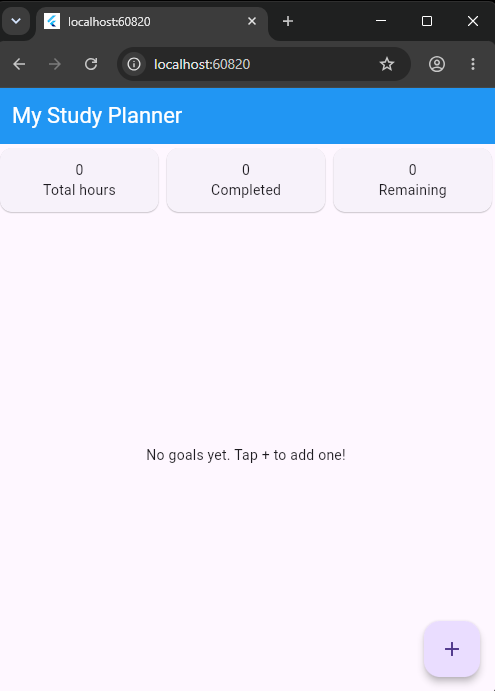

# My Study Planner

**Group Number:** Group 13

## Group Members
| # | Student ID |
| :--- | :--- |
| 1 | 27052/2024 |
| 2 | 26344/2024 |
| 3 | 26345/2024 |
| 4 | 26488/2024 |
| 5 | 26218/2024 |
## Project Progress

- [x] **Phase 1: Static Screen** — Basic UI layout with AppBar, title, and fixed study goal cards.
- [x] **Phase 2: Working List** — Interactive list allowing users to add, mark as done, and delete study goals.
- [x] **Phase 3: Statistics & Cards** — Live summary cards (Total hours, Completed, Remaining) using a reusable widget and an empty-state message.
- [ ] **Phase 4: Second Screen**
- [ ] **Phase 5: Database Persistence**

## Screenshots

### Phase 1 - Static Screen

### Phase 2 - Working List

### Phase 3 - Statistics & Cards

